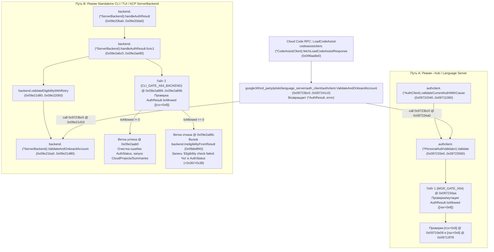

# Технический отчёт: Реверс-инжиниринг Antigravity CLI 1.5.15 (Linux x86_64) и аудит кода

> [!NOTE]
> Исследование выполнено в режиме статического анализа с использованием **MCP REA** (декомпиляция Ghidra 12.2 по восстановленной из `.gopclntab` таблице символов Go) и верифицировано независимым агентом-ревьюером.

---

## 1. Метаданные исследуемого бинарника и доказательная база REA

### 1.1. Характеристики исполняемого файла
* **Путь**: `/home/jd_ebash/.local/share/mise/installs/antigravity-cli/1.5.15/antigravity`
* **Формат**: `ELF64 x86-64`, `ET_DYN` (Position-Independent Executable), stripped (`275,067,592` байт).
* **Сборка Go** (секция `.go.buildinfo`, VMA `0x0dcc30a0` / файловое смещение `0x0d4c30a0`):
  `go1.28-20261102-RC01 cl/1012564305 +298f53e483 X:fieldtrack,boringcrypto,nogolistexport`.
* **Секция `.text`**:
  * Виртуальный адрес (VMA): `0x0734d000`
  * Файловое смещение (File Offset): `0x0734d000`
  * Размер: `0x044c39d0` (`72,104,400` байт)
  * Поскольку `VMA == File Offset`, любой виртуальный адрес инструкции внутри `.text` численно равен её смещению от начала файла.
* **Таблица символов Go (`.gopclntab`)**:
  * Расположена в секции `.lrodata` по смещению `0x01845c60`.
  * Заголовок: `magic = 0xfffffff1` (Go 1.20+), `minLC = 1`, `ptrSize = 8`, `nfunc = 191,656`, `nfiles = 7,461`.
  * Базовый адрес кода Go (`runtime.text`): `0x0734d080`.
* **Контрольные суммы (SHA-256)**:
  * Стоковый бинарник `1.5.15` (бэкап в `antigravity.ag-backups/`): `05245f4346d16b679fd059a73081af0161607a76b4a164642bd007430934e785`
  * Текущий бинарник с профилем `agy-x64-backend-v4`: `b6db52cfa7909d7c06ed76ca5e1c018337972984029b6a06c8649e3cc939478a`
  * Побайтовая разница между стоковым и модифицированным файлами: ровно **2 участка (9 байт)** — по смещениям `0x097234aa..0x097234af` и `0x09e2a892..0x09e2a895`.

### 1.2. Реестр артефактов и доказательств MCP REA

| ID доказательства REA | Инструмент REA | Объект / Назначение |
| :--- | :--- | :--- |
| `ev_2563e9c6819b3b604b4c5446b799cfb87e90a684b289274aa1b477c7543bc9cb` | `inspect_desktop_application` | Инвентаризация каталога установки `1.5.15/` и журнала `antigravity.ag-backups/` |
| `ev_a78668459a6afc6e585566ecd42464a223baab09a01bb99b964eae1aac367aa4` | `inspect_go_binary` | Анализ модифицированного бинарника `antigravity` |
| `ev_0ac7c737a2bcebe7b04ea877f8c9d3a437725b49502adc9231e34e808204cb32` | `inspect_go_binary` | Анализ стокового бэкапа `05245f43...bin` |
| `ev_5f803a2c78c8642a12e3c31d4f6495d1d73ba37c2dd21f7b7bc0f976e9823caf` | `inspect_with_objdump` | Таблица секций ELF (`section_headers`) |
| `ev_2211b0d2d7058a59db59e42a976c09ea9f839ac0af0bd1220ed0fb7f245de7b7` | `inspect_binary_hardening` | Проверка защитных механизмов ELF (PIE, RELRO, NX) |
| `ev_4728950550a4a911298fa717f55d1709f625dae55329bdb57066c72f33185e77` | `procedure_pseudo_code` | Декомпиляция `authclient.ValidateAndOnboardAccount` (`0x09723bc0`) |
| `ev_244d6b8d46432d611564e2f4e4c8c8addef95c35e7bc6a30ce40bdf4ce109015` | `analyze_function` | Декомпиляция `authclient.(*PersonalAuthValidator).Validate` (`0x097233e0`) |
| `ev_a8892631504c7dab0fa91ab6746e471b6e4ea881169772fee9c82aceee0e3a6b` | `procedure_pseudo_code` | Декомпиляция `authclient.(*EnterpriseAuthValidator).Validate` (`0x09723560`) |
| `ev_dc42c571289a3961c698816b611c5e8c9b9862d121e733c1a92171fc52dc16d7` | `procedure_pseudo_code` | Декомпиляция `authclient.buildErrorResp` (`0x0971dc80`) |
| `ev_842172fd8132f6d67a68c3f9359e18953e1df01cd5ffc19b356abb35dcce50be` | `analyze_function` | Декомпиляция `backend.IneligibilityFromResult` (`0x09de8f40`) |
| `ev_f27b4cbfe72b779952ae47fc0257e941a69f3c5620045e48d5369a5b6e2900ae` | `procedure_pseudo_code` | Декомпиляция `backend.applyIneligibilityURLs` (`0x09de9100`) |
| `ev_6e70d75891b1dc3be1bf73bad8f15e5ddbd89a6daa18f20d2a0514ae24729623` | `procedure_pseudo_code` | Декомпиляция `backend.(*AuthStatus).EligibilityError` (`0x09de8d20`) |
| `ev_4861e83e26bd34982854c13c92356ca48f9dcdf6c24bda752f6b91d174f97c3d` | `procedure_pseudo_code` | Декомпиляция `backend.(*ServerBackend).handleAuthResult` (`0x09e20ba0`) |
| `ev_3e473e9dcc19166932eb19f25cd027f2f0120d8618d835a00e4bbb3ce0cc2bd1` | `procedure_pseudo_code` | Декомпиляция `backend.(*ServerBackend).applyAuthResult` (`0x09e21260`) |
| `ev_3f1a27282e1ae3319e52adc31ecd457806633076876958d141c4d44204c1af07` | `procedure_pseudo_code` | Декомпиляция `backend.(*ServerBackend).ValidateAndOnboardAccount` (`0x09e21ba0`) |
| `ev_d2711e3b3e5968e387a382ffa47529da434dd3693a163d83963e0dd9a60d968d` | `analyze_function` | Декомпиляция `backend.(*ServerBackend).handleAuthResult.func1` (`0x09e2a6c0`) |

---

## 2. Архитектура проверки локации и элигибельности в Antigravity CLI 1.5.15

### 2.1. Общая схема графа вызовов



---

### 2.2. Источник формирования `AuthResult`: `authclient.ValidateAndOnboardAccount` (`0x09723bc0..0x097241c0`)

На основе декомпиляции REA (`ev_4728950550a4a911298fa717f55d1709f625dae55329bdb57066c72f33185e77`) и дизассемблирования:

1. **Запрос к серверу**:
   По адресу `0x09723c6c` вызывается `codeassistclient.(*CodeAssistClient).fetchLoadCodeAssistResponse` (`0x096aa8e0`).
2. **Анализ ответа `LoadCodeAssistResponse`**:
   * По смещению `+0x30` в ответе находится срез `allowed_tiers`. Проверяется наличие тарифа `"free-tier"` (9 байт: `0x6569742d65657266` + `'r'`).
   * По смещению `+0x38` (указатель) и `+0x40` (длина) находится срез `ineligible_tiers`. В цикле `0x09723dff..0x09723f35` каждая запись логируется с форматом `"Ineligible tier: %+v"` (`0x06617389`) и проверяется на `tier_id == "free-tier"`.
3. **Ветвление при обнаружении регионального/аккаунтного ограничения (`0x09723f53..0x09723f65`)**:
   * Если `"free-tier"` не найден в `allowed_tiers` и при этом присутствует в `ineligible_tiers`, по адресу `0x09723f65` выполняется переход `0f 85 f0 00 00 00` (`jne 0x972405b`).
   * В блоке `0x0972405b..0x0972415c`:
     * Проверяется длина `reason_message` (`[rax+0x18]`). Если сообщение не пустое:
     * По адресу `0x09724100` вызывается `runtime.newobject` (`0x07373460`) для типа `authclient.AuthResult` (`0x0d263370`).
     * Поле **`AuthResult.IsAllowed`** (байт по смещению **`+0x8`**, т.е. `[rax+0x8]`) остаётся равным **`0` (`false`)**.
     * Заполняются поля `ReasonMessage` (`+0x10/+0x18`) и `Detail` (`+0x48` = тип `IneligibleDetail` `0x0d3c40a0`, `+0x50` = структура с `reason_code` и `validation_url`).
     * По адресу `0x0972415c` функция возвращает `(*AuthResult, nil)` — **ошибка `error` равна `nil`**, а отказ закодирован флагом `AuthResult.IsAllowed == false`.
4. **Ветка успешной валидации (`0x09723f6a..0x0972402a`)**:
   * Проверяется `LoadCodeAssistResponse.current_tier` (`[r10+0x8]` по `0x09723f78`). Если он равен `nil`, вызывается `codeassistclient.(*CodeAssistClient).OnboardUser` (`0x096abd20` по `0x09723fc2`) с аргументом `"free-tier"`.
   * Вызывается `codeassistclient.(*CodeAssistClient).GetUserStatus` (`0x096ad1a0` по `0x09723fe9`).
   * По адресу `0x0972401a..0x0972402a` создаётся `AuthResult` (`0x0d263370`) и инструкцией `c6 40 08 01` (`0x09724026`) устанавливается **`mov byte ptr [rax+0x8], 0x1`** (`IsAllowed = true`).

---

### 2.3. Путь A (`--hub` / Language Server): `PersonalAuthValidator.Validate` (`0x097233e0..0x09723560`)

При работе в режиме `--hub` (или в отдельном бинарнике `language_server_linux_x64`) цепочка проверки проходит через `authclient.(*AuthClient).validateCurrentAuthWithCause` (`0x09710340..0x09711060`), который вызывает метод валидатора `authclient.(*PersonalAuthValidator).Validate` (`0x097233e0`, REA `ev_244d6b8d46432d611564e2f4e4c8c8addef95c35e7bc6a30ce40bdf4ce109015`):

* По адресу `0x097234a0`: `call 0x9723bc0` (`authclient.ValidateAndOnboardAccount`). Возвращает `*AuthResult` в `RAX` и `error` в `RBX`/`RCX`.
* По адресу `0x097234a5`: `test rbx, rbx; jne 0x97234eb` (если произошла сетевая ошибка RPC, выход).
* По адресу **`0x097234aa..0x097234af`** (6 байт):
  * В стоковом бинарнике: `80 78 08 00 74 3b` (`cmp byte ptr [rax+0x8], 0x0; je 0x97234eb`). Если `IsAllowed == 0`, функция сразу выходит на эпилог `0x097234eb`, возвращая `AuthResult` с `[rax+0x8] == 0`.
  * В профиле `MGR_GATE_X64`: эти 6 байт заменяются на `c6 40 08 01 90 90` (`mov byte ptr [rax+0x8], 0x1; nop; nop`). Поскольку эта инструкция изменяет само поле `AuthResult.IsAllowed = 1` в памяти структуры, все последующие проверки этого объекта в `AuthClient` (`0x09710e09: cmp byte ptr [rcx+0x8], 0x0` в `validateCurrentAuthWithCause` и `0x09713f78: cmp byte ptr [rax+0x8], 0x0` в `finalizeLoginAfterValidate`) видят `IsAllowed == 1`.

---

### 2.4. Путь B (Standalone CLI / TUI / ACP): `ServerBackend.handleAuthResult.func1` (`0x09e2a6c0..0x09e2ae80`)

При запуске интерактивного CLI, TUI, printmode или ACP-сервера (`cli/acp/server.(*Server).handleAuthenticate` по `0x0ad57740`) используется `ServerBackend`:

1. `backend.(*ServerBackend).handleAuthResult` (`0x09e20ba0..0x09e20da0`, REA `ev_4861e83e26bd34982854c13c92356ca48f9dcdf6c24bda752f6b91d174f97c3d`) применяет OAuth-токен (`applyAuthResult` `0x09e21260`), инициализирует флаги `AuthStatus` (`0x09e20cc5: mov word ptr [rax+0x70], 0x100`) и запускает горутину `backend.(*ServerBackend).handleAuthResult.func1` (`0x09e2a6c0`, REA `ev_d2711e3b3e5968e387a382ffa47529da434dd3693a163d83963e0dd9a60d968d`).
2. `handleAuthResult.func1` вызывает `backend.validateEligibilityWithRetry` (`0x09e21d80`), которая через замыкание `0x09e3b100` вызывает `backend.(*ServerBackend).ValidateAndOnboardAccount` (`0x09e21ba0`, REA `ev_3f1a27282e1ae3319e52adc31ecd457806633076876958d141c4d44204c1af07`).
3. Для пользовательской авторизации Google (`target != "gcp"` и `!= "adc"`) `ServerBackend.ValidateAndOnboardAccount` по адресу **`0x09e21d19`** напрямую вызывает `authclient.ValidateAndOnboardAccount` (`0x09723bc0`), **полностью обходя `PersonalAuthValidator.Validate` (`0x097233e0`)**.
4. Из-за этого модификация в `PersonalAuthValidator.Validate` (`0x097234aa`) в данном пути вообще не исполняется. В `handleAuthResult.func1` возвращается `*AuthResult` (в регистре **`RCX`**) с `IsAllowed == 0` (`[rcx+0x8] == 0`) и `err == nil` (`RAX = 0`).
5. В точке `0x09e2a880..0x09e2a8a5` (`37` байт) находится проверка результата:

| Адрес / Смещение | Байты (Сток) | Байты (`agy-x64-backend-v4`) | Инструкция и роль |
| :--- | :--- | :--- | :--- |
| `0x09e2a880` | `48 85 c0` | `48 85 c0` | `test rax, rax` (проверка `err != nil`) |
| `0x09e2a883` | `0f 85 54 03 00 00` | `0f 85 54 03 00 00` | `jne 0x9e2abdd` (ветка ошибки `"Validation failed: %v"`) |
| `0x09e2a889` | `48 85 c9` | `48 85 c9` | `test rcx, rcx` (проверка `res == nil`; при `rcx != 0` сбрасывает `ZF = 0`) |
| `0x09e2a88c` | `0f 84 1e 02 00 00` | `0f 84 1e 02 00 00` | `je 0x9e2aab0` (переход в ветку успеха при `res == nil`) |
| **`0x09e2a892`** | **`80 79 08 00`** | **`90 90 90 90`** | Сток: `cmp byte ptr [rcx+0x8], 0x0`<br/>Патч: `nop; nop; nop; nop` (сохраняет `ZF = 0` от `test rcx, rcx`) |
| `0x09e2a896` | `0f 85 14 02 00 00` | `0f 85 14 02 00 00` | `jne 0x9e2aab0` (переход в ветку успеха `0x09e2aab0`) |
| `0x09e2a89c` | `48 89 c8 90` | `48 89 c8 90` | `mov rax, rcx; nop` (подготовка аргумента для `IneligibilityFromResult`) |
| `0x09e2a8a0` | `e8 9b e6 fb ff` | `e8 9b e6 fb ff` | `call 0x9de8f40` (`backend.IneligibilityFromResult`) |

---

### 2.5. Причина отказа апстримного профиля `agy-x64-cli-hub-v3` на Linux CLI 1.5.15

1. В более ранних сборках CLI компилятор Go размещал указатель `*AuthResult` в регистре **`RAX`** как в гейте `handleAuthResult.func1`, так и во вспомогательной функции форматирования причины отказа `backend.IneligibilityFromResult` (`0x09de8f40..0x09de9100`, REA `ev_842172fd8132f6d67a68c3f9359e18953e1df01cd5ffc19b356abb35dcce50be`).
2. Апстримный поисковик `x64_cli_gates()` (`src/core/patcher.rs`) искал только сигнатуру с регистром `RAX` (`48 85 c0 0f 84 .... 80 78 08 00 0f 85 ....`) и допускал **от 1 до 2 совпадений** (`(1..=2).contains(&gates.len())`).
3. В сборке CLI `1.5.15` (Go 1.28) в `handleAuthResult.func1` компилятор выделил под `*AuthResult` регистр **`RCX`**, тогда как в `backend.IneligibilityFromResult` (`0x09de8f60`) остался **`RAX`**:
   ```assembly
   09de8f60: 48 85 c0             test   rax, rax
   09de8f63: 0f 84 4e 01 00 00    je     0x9de90b7
   09de8f69: 80 78 08 00          cmp    BYTE PTR [rax+0x8], 0x0
   09de8f6d: 0f 85 44 01 00 00    jne    0x9de90b7
   ```
4. В результате апстримный патчер находил единственное `RAX`-совпадение в диагностическом хелпере `IneligibilityFromResult` (`0x09de8f69`), модифицировал его, считал задачу выполненной, но реальный гейт в `handleAuthResult.func1` (`0x09e2a892`) продолжал блокировать вход, вызывая модифицированный `IneligibilityFromResult` и записывая в `AuthStatus` (`+0x30/+0x38` по `0x09e2aa66..0x09e2aa83`) пустую ошибку `"Eligibility check failed: "`.

---

## 3. Аудит изменений в репозитории (`git diff`)

### 3.1. Анализ логики `x64_backend_cli_gate` и профиля `agy-x64-backend-v4`
Изменения в `src/core/opcodes.rs` и `src/core/patcher.rs` обладают высокой точностью:
* **Контекстная привязка**: `CLI_GATE_X64_BACKEND_ORIG_REGEX` проверяет 37-байтовый блок целиком, включая предшествующий `test rax, rax; jne <error>` и последующий `call <helper>`.
* **Проверка целей ветвления**: `x64_backend_cli_gate` верифицирует, что оба условных перехода (`je` по `+12` и `jne` по `+22`) указывают на одну и ту же инструкцию ветки успеха (`0x09e2aab0`), а переход ошибки (`jne` по `+3`) ведёт на отличный от неё адрес (`0x09e2abdd`).
* **Верификация вызова хелпера**: проверяется, что относительный `call` в конце блока (`0x09e2a8a0`) ведёт ровно на `helpers[0].0 - 32` (`0x09de8f60 - 32 = 0x09de8f40`, точку входа `backend.IneligibilityFromResult`), при этом сам хелпер `IneligibilityFromResult` обязан находиться в стоковом состоянии (`X64GateState::Stock`).
* **Отсутствие побочных эффектов в ветке `0x09e2aab0`**: декомпиляция `handleAuthResult.func1` (`ev_d2711e3b3e5968e387a382ffa47529da434dd3693a163d83963e0dd9a60d968d`) подтверждает, что после перехода на `0x09e2aab0` регистр `RCX` (`*AuthResult`) больше не разыменовывается.

---

### 3.2. Выявленные и устранённые краевые случаи в кодовой базе

1. **Проверка legacy-бэкапов без журнала (`legacy_cli_backup_matches` в `src/core/patcher.rs`)**:
   * **Проблема**: когда бинарник `1.5.15` был ранее модифицирован профилем `agy-x64-cli-hub-v3`, в нём изменены два участка: `IneligibilityFromResult` (`CLI_GATE_X64_LONG_FIX` по `0x09de8f69`) и `PersonalAuthValidator.Validate` (`MGR_GATE_X64_FIX` по `0x097234aa`). При наличии журнала (`antigravity.ag-backups/current.json`) миграция на `agy-x64-backend-v4` шла через `journal::verified_original`, но для внешнего `.bak` / `.original` файла без журнала `legacy_cli_backup_matches(original, current)` накладывала только `CLI_GATE_X64_LONG_FIX` без `MGR_GATE_X64_FIX`.
   * **Решение**: в `legacy_cli_backup_matches` добавлено применение `MGR_GATE_X64_FIX` к секции `.text` при сверке с внешним бэкапом, а также добавлен регрессионный тест миграции и отката по `.bak`-файлу.
2. **Потеря путей `mise` при повышении привилегий через `sudo` (`src/core/detector.rs` и `scripts/patch_cli_linux.sh`)**:
   * **Проблема**: `sudo` сбрасывает переменную `PATH` до системного `secure_path` (удаляя из неё `~/.local/share/mise/installs/antigravity-cli/latest` и `~/.local/share/mise/shims`), а при использовании `shims` симлинк `antigravity` указывает на `/usr/bin/mise`.
   * **Решение**: в `cli_search_dirs()` (`src/core/detector.rs`) добавлены пути `.local/share/mise/installs/antigravity-cli/{latest,global}` (и подкаталоги `bin`), а в `scripts/patch_cli_linux.sh` добавлены автоматический обход `mise`-шимминга (`mise which`), инкрементальная сборка Cargo и флаги `--status` / `--restore` (через новую команду `restore-files`).
3. **Чувствительность `linux_lsof_stderr_is_safe` к посторонним точкам монтирования (`src/system/file_lock.rs`)**:
   * **Проблема**: при запуске `lsof` от имени `root` в ряде окружений/песочниц возникают предупреждения `lsof: WARNING: can't stat() efivarfs file system /sys/firmware/efi/efivars` (а также `tracefs`/`debugfs`).
   * **Решение**: в `linux_lsof_stderr_is_safe` добавлена поддержка системных точек монтирования `efivarfs` (`/sys/firmware/efi/efivars`), `tracefs` и `debugfs` с сохранением проверки того, что целевой файл находится вне этих точек монтирования.

---

## 4. Сравнительный анализ архитектурных точек проверки

| Точка анализа в бинарнике | Адрес / Функция | Механика работы | Архитектурная оценка |
| :--- | :--- | :--- | :--- |
| **1. Уровень потребителей `AuthResult` (`agy-x64-backend-v4`)** | `0x097234aa` (`PersonalAuthValidator.Validate`) и `0x09e2a892` (`ServerBackend.handleAuthResult.func1`) | Перехватывает проверку байта `AuthResult.IsAllowed` (`+0x8`) после того, как `ValidateAndOnboardAccount` штатно завершилась с `err == nil`. | Не вызывает лишних сетевых RPC (`OnboardUser` / `GetUserStatus`) для неподдерживаемого тарифа; инструкции заменяются размер-в-размер (6 и 4 байта) без сдвига смещений. |
| **2. Уровень аллокации `AuthResult` в источнике** | `0x09724100..0x0972415c` (`authclient.ValidateAndOnboardAccount`) | Создание объекта `AuthResult` на ветке `IneligibleTier`. | Хотя `ValidateAndOnboardAccount` является общим корнем для обоих путей (`--hub` и `ServerBackend`), поле `IsAllowed = 0` (`[rax+0x8]`) формируется там за счёт нулевой инициализации `runtime.newobject`, поэтому отдельной инструкции записи `0` в `[rax+0x8]` для замены на месте там нет. |
| **3. Пропуск ветки `IneligibleTier` перед `OnboardUser`** | `0x09723f65` (`jne 0x972405b` в `authclient.ValidateAndOnboardAccount`) | Принудительный переход к проверке `current_tier`, вызову `OnboardUser` (`0x096abd20`) и `GetUserStatus` (`0x096ad1a0`). | **Ненадёжно**: если для аккаунта с `IneligibleTier` сервер отклонит RPC `OnboardUser` или `GetUserStatus`, `ValidateAndOnboardAccount` перейдёт на `0x0972402b` (`buildErrorResp`) и вернёт ненулевой `error`, что приведёт к аварийному выходу по `0x09e2a883` (`"Validation failed: %v"`). |
